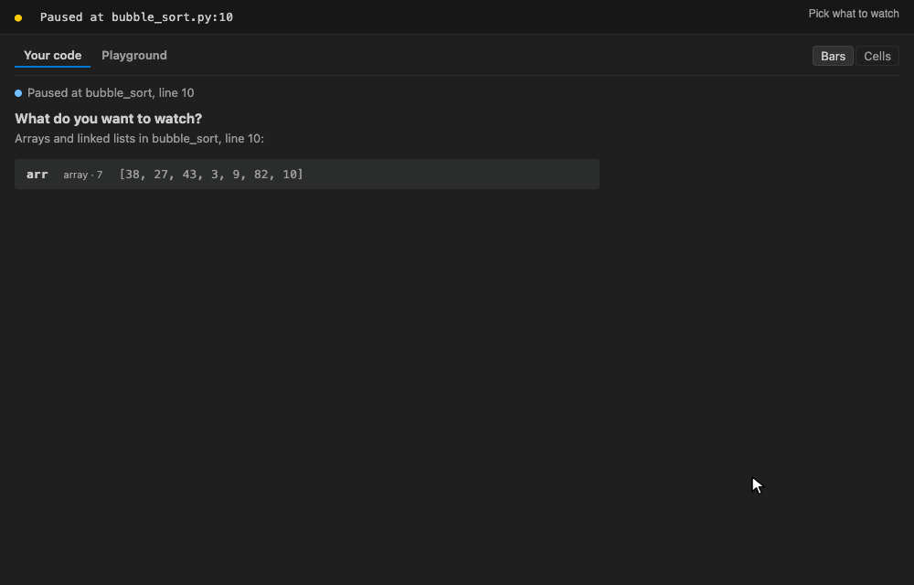
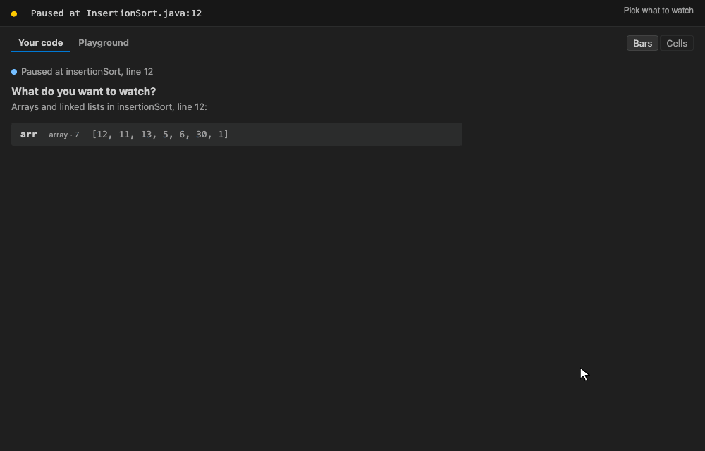
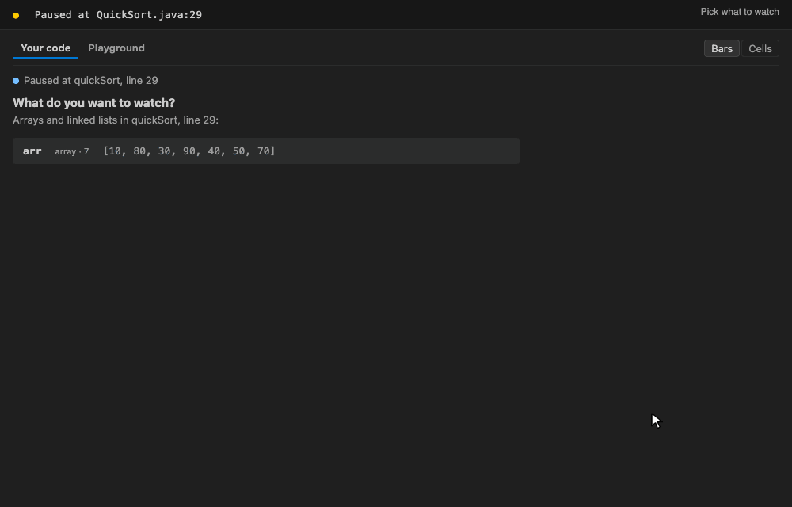
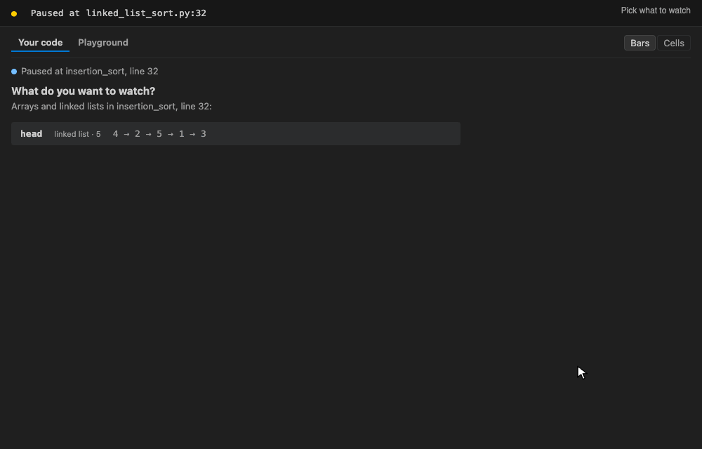
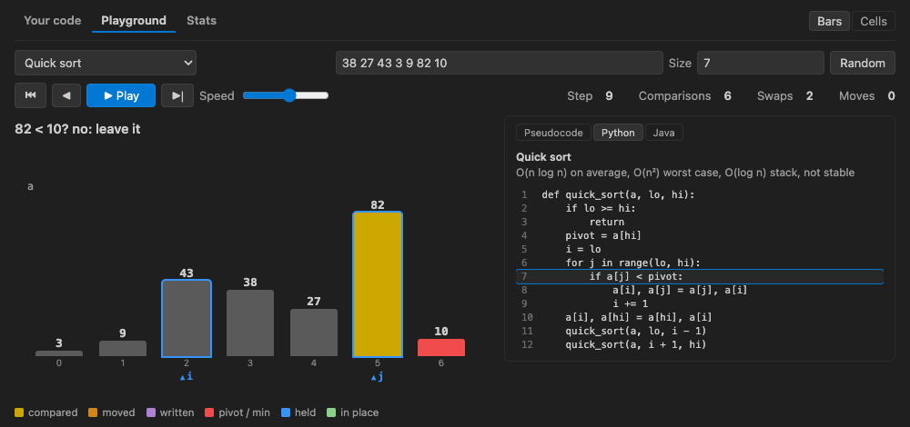
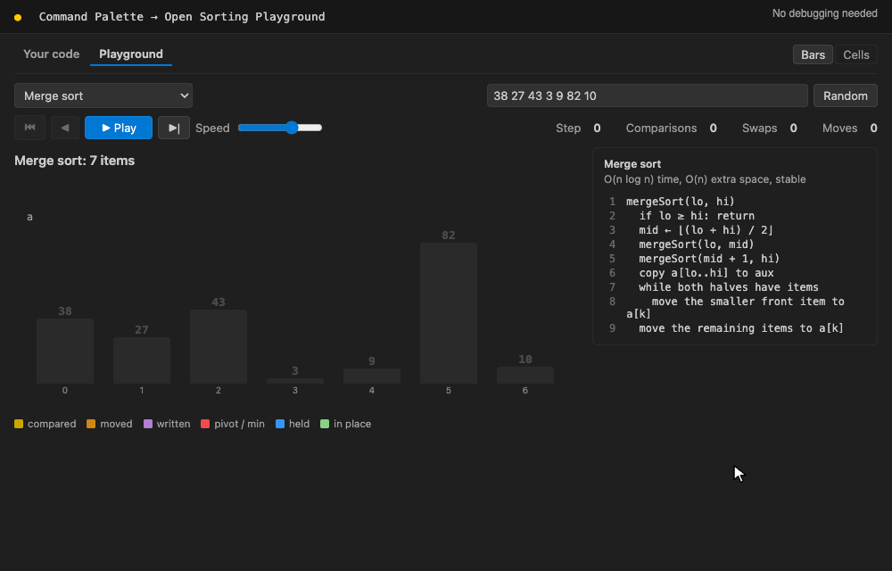
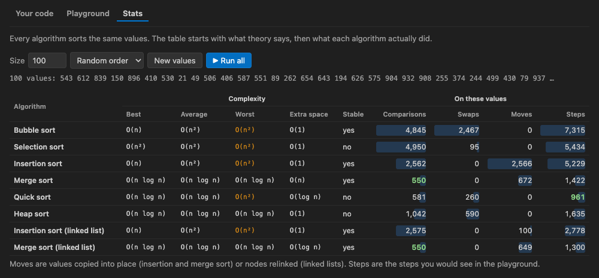

# Debug Sorting Algorithms Visualizer

Watch your own sorting code while you debug. Stop at a breakpoint in your bubble sort, quick sort or linked list sort, press **Play**, and every step animates what your code did: the swaps, the shifts, the merges and the relinked nodes. In Python and Java. Plus a playground with the classic algorithms in pseudocode, Python and Java, and a Stats tab that runs them all on the same values.

## ✨ Features

- 🐞 **Your code, animated**: the array or linked list your code sorts, redrawn at every step of the debugger, with what changed described ("Swapped 27 and 38", "arr[3] = 43", "2.next → 4")
- ▶️ **Play**: steps through your code by itself (Step Over, Step Into for recursion, or breakpoint to breakpoint), at a speed you change while it plays (up to 3 s per step), and stops by itself when the structure is sorted
- ⏪ **History**: go back and forth through the steps already drawn, which the debugger itself cannot do
- 👉 **Pointers and values**: `i`, `j`, `low`, `high`, `min_index` drawn under the array; `key`, `temp`, `pivot`, `swapped` as values above it
- 🔁 **Recursion**: the array you picked stays drawn inside recursive calls (merge sort, quick sort, heap sort), with the sub-arrays of the current call
- 🔗 **Linked lists**: every list from its first node, nodes that keep their place when relinked, and the variables that point to them
- 🧪 **Playground**: bubble, selection, insertion, merge, quick and heap sort on an array, insertion and merge sort on a linked list, shown as pseudocode, Python or Java with the current line highlighted, comparisons and swaps counted; on your own values, random ones of the size you choose, or the ones from your code
- 📊 **Stats**: all 8 algorithms on the same values (2 to 500, random, nearly sorted, reversed or sorted): their complexity, then the comparisons, swaps and moves they actually made
- 🎨 **Bars or cells**, in the colours of your VS Code theme
- 🐍☕ **Python and Java**, tested with the debuggers VS Code uses for both

## 🚀 Quick Start

1. **Set a breakpoint** in your sorting function and start debugging (F5).
2. **When the program stops**, open the visualizer:
   - the **Sorting** button in the status bar
   - the sorting icon at the top right of the editor, or in the debug toolbar
   - right-click the array in the **Variables** view → **Visualize Sorting** (opens it directly)
3. **Click the array or linked list** in the list of what can be sorted in the current frame.
4. **Press Play**: it steps over your code by itself, slower or faster with **Speed**. Or step yourself with **Step Over** (F10) and watch it change.

No breakpoint yet? Try the [examples](#-try-it-with-the-examples), or run **Open Sorting Playground** from the Command Palette.

## 🐞 Your Code

### Arrays

Python lists, Java arrays and `ArrayList`s of numbers or strings. Every change is animated: values that change places move, and a value written into a cell flies in from where it was copied, whether another cell, another array or a variable such as `key` or `temp`.

- **Pointers**: int variables of the current function that are positions in the array (`i`, `j`, `low`, `high`, `min_index`, `largest`...) are drawn under it. Counts and values (`n`, `key`, `temp`, `pivot`) are shown as values.
- **Swaps**: a swap in one line (`a[i], a[j] = a[j], a[i]`) and a swap through a temporary variable over three lines both count as one swap.
- **Sorted**: when the array holds the values it started with, in order, it turns green and Play stops.

### Recursion

Choose **Play with Step Into (recursion)** for recursive algorithms. The array you picked stays drawn while the recursive calls run (its label says where it is read from), and the arrays of the current call (`left`, `right`, `leftPart`...) are drawn below it.

### Linked lists

Nodes with a `next` field and a value field (`value`, `val`, `data`, `key`...). Every list is drawn from its first node, using the node variables of every function on the call stack, so the nodes a recursive call does not see stay drawn. Variables pointing into a list (`current`, `walker`, `slow`, `fast`) are pointers under their node, and every `node.next = ...` is described and counted.

## 🧪 Playground

**Open Sorting Playground** (Command Palette) works without debugging. Pick an algorithm, type your values (or choose a **Size** from 2 to 40 and press **Random**, or **From your code**), and press **Play**. The step back button and the arrow keys go through the algorithm in both directions, with comparisons, swaps and moves counted.

The algorithm is shown as **Pseudocode**, **Python** or **Java**, with the line running now highlighted:

| Algorithm | On | Time | Extra space | Stable |
|---|---|---|---|---|
| Bubble sort | array | O(n²) | O(1) | yes |
| Selection sort | array | O(n²) | O(1) | no |
| Insertion sort | array | O(n²), O(n) almost sorted | O(1) | yes |
| Merge sort | array | O(n log n) | O(n) | yes |
| Quick sort | array | O(n log n) average, O(n²) worst | O(log n) | no |
| Heap sort | array | O(n log n) | O(1) | no |
| Insertion sort | linked list | O(n²) | O(1) | yes |
| Merge sort | linked list | O(n log n) | O(log n) | yes |

While debugging, **Try an algorithm on this data** runs the values of your array in the playground.

## 📊 Stats

Theory and practice side by side. Choose a **Size** (2 to 500) and an order (random, nearly sorted, reversed, already sorted), press **Run all**, and every algorithm sorts the same values. The table shows each algorithm's best, average and worst case, extra space and stability, then the comparisons, swaps, moves and steps it actually made, with the fewest in green.

Try **Already sorted**: insertion sort and bubble sort make only n − 1 comparisons, while selection sort still makes n(n − 1)/2.

## 🧪 Try It with the Examples

The [`examples`](examples/) folder has one folder per algorithm, each with a Python program, a Java program and a README listing what you should see:

| Folder | Algorithm |
|---|---|
| [01-bubble-sort](examples/01-bubble-sort/) | Bubble sort |
| [02-selection-sort](examples/02-selection-sort/) | Selection sort |
| [03-insertion-sort](examples/03-insertion-sort/) | Insertion sort |
| [04-merge-sort](examples/04-merge-sort/) | Merge sort |
| [05-quick-sort](examples/05-quick-sort/) | Quick sort |
| [06-heap-sort](examples/06-heap-sort/) | Heap sort |
| [07-linked-list-sort](examples/07-linked-list-sort/) | Insertion sort and merge sort on a linked list |

[Download the repository](https://github.com/MCCProgrammer/debug-sorting-algorithms-visualizer/archive/refs/heads/main.zip), open the `examples` folder in VS Code, set a breakpoint on the line marked `BREAKPOINT` and press F5 with **Python: current file** or **Java: current file**.

## 🖱️ In the Panel

- **Step Over / Step Into / Step Out / Continue** control the debugger from the panel.
- **Play** steps by itself at the chosen **Speed**, which you can change while it plays; **Pause** (or Space) stops it.
- **◀ ▶** (or the arrow keys) go through the steps already drawn; **Back to live** returns to the current one.
- **Watch something else** returns to the list of arrays and linked lists.
- **Bars / Cells** switches how values are drawn (text is always drawn in cells).
- **Your code / Playground / Stats** tabs at the top.
- Starting a new debug session with the panel open watches the same variable again.

## 🌐 Languages

| Language | Debugger | Status |
|---|---|---|
| Python | Python Debugger (debugpy) | Tested |
| Java | Debugger for Java | Tested |
| JavaScript / TypeScript, C#, Kotlin | Their usual VS Code debuggers | Should work (values are read the same way), not tested yet |

## 🔧 Requirements

- VS Code 1.85 or later, or an editor based on it (Cursor, VSCodium, Windsurf...)
- A debugger for your language: **Python Debugger** for Python, **Extension Pack for Java** for Java

## 🐛 Troubleshooting

**My array is not listed**: it has to hold numbers or strings, and exist in the function where the program stopped (a local variable, or a field of `self` / `this`). Step until it exists, or right-click it in **Variables** → **Visualize Sorting**.

**Play goes too fast through a recursive sort**: Step Over runs a whole recursive call in one step. Choose **Play with Step Into (recursion)**.

**The pointers are shown as values**: when the current function has more than one array (`left`, `right`, `temp`), an index could belong to any of them, so it is shown as a value instead.

**Arrays are cut**: up to 64 items are drawn.

Found a bug or have an idea? [Open an issue](https://github.com/MCCProgrammer/debug-sorting-algorithms-visualizer/issues) or write to [contact@mccprogrammer.com](mailto:contact@mccprogrammer.com).

## 🗺️ Roadmap

- Race mode: two algorithms animated side by side on the same data
- Your own code as a row in Stats, compared with the playground algorithms
- Shell sort, counting sort and radix sort in the playground

## 🌳 Also by MCCProgrammer

[Debug Data Structures Visualizer](https://marketplace.visualstudio.com/items?itemName=MCCProgrammer.debug-dataStructures-visualizer-extension) draws your trees, linked lists, stacks, queues, heaps and hash tables while you debug.

## ❤️ Support

If the extension helps you, a [rating on the Marketplace](https://marketplace.visualstudio.com/items?itemName=MCCProgrammer.debug-sorting-algorithms-visualizer&ssr=false#review-details) or a coffee on [Ko-fi](https://ko-fi.com/mccprogrammer) makes a big difference.

## 📬 Contact

Questions, feedback or ideas: [contact@mccprogrammer.com](mailto:contact@mccprogrammer.com).

## 📄 License

MIT
